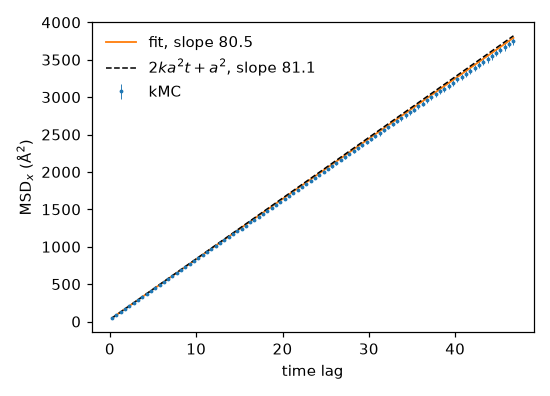

# One-dimensional diffusion

The first example of the KMCLib manual: a single particle performing a random walk.

A periodic chain of 10 sites, 5.2 Å apart, holds one "B" particle in a sea of "A" particles.
The "B" particle swaps place with its left or its right neighbour, each with the rate constant
`k = 1.5` per unit of time. Its mean square displacement (MSD) is collected during the run.

## What it shows

- the basic objects: `KMCUnitCell`, `KMCLattice`, `KMCConfiguration`, `KMCProcess`,
  `KMCInteractions`, `KMCLatticeModel`, `KMCControlParameters`;
- the built-in `OnTheFlyMSD` analysis, its `printResults`, `results`, `stdDev` and `safeCutoff`;
- writing a trajectory in xyz format.

## Run

```bash
python diffusion_1d.py            # about 5 s
python diffusion_1d.py --plot     # also writes output/diffusion_1d.png (needs matplotlib)
python diffusion_1d.py --help
```

The results go to `output/`: `msd.data` (the table printed by the analysis), `traj.xyz`.

## Expected result

For an unbiased walk with hop length `a` the MSD is a straight line in the time lag `t`:

```
MSD(t) = 2 k a² t + a²
```

The slope is twice the diffusion coefficient, `D = k a²`. The offset `a²` appears because
positions are recorded right after a hop: an interval between two recorded positions always
contains the hop that ends it, on top of the `2 k t` hops expected in a time `t`.

|       | slope (Ų per unit time) | offset (Ų) |
| ----- | ------------------------ | ----------- |
| exact | 81.12                    | 27.04       |
| kMC, default seed | 80.55        | 27.21       |
| kMC, 11 seeds, mean ± standard deviation | 81.14 ± 0.50 | 27.03 ± 0.15 |



Two details matter for this agreement:

- The position is recorded after every step (`analysis_interval=1`). When only every n-th step
  is recorded the MSD is still linear at long time lags, but no longer at short ones.
- `OnTheFlyMSD` estimates the error of each point as a fraction of the measured value. The fit
  uses these relative errors together with the time lag as weights, not the absolute errors:
  points that happen to lie low would otherwise get a larger weight.

## Command line

This model ships with pykmclib as a Hydra configuration:

```bash
pykmclib model=diffusion1d
```

## References

- M. Leetmaa and N. V. Skorodumova, *KMCLib: A general framework for lattice kinetic Monte Carlo
  (KMC) simulations*, Comput. Phys. Commun. 185 (2014) 2340.
  DOI: [10.1016/j.cpc.2014.04.017](https://doi.org/10.1016/j.cpc.2014.04.017)
- M. Leetmaa and N. V. Skorodumova, *Mean square displacements with error estimates from
  non-equidistant time-step kinetic Monte Carlo simulations*, Comput. Phys. Commun. 191 (2015) 119.
  DOI: [10.1016/j.cpc.2015.02.006](https://doi.org/10.1016/j.cpc.2015.02.006)
