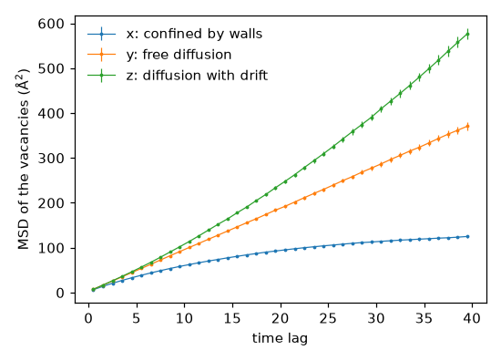

# Three-dimensional vacancy diffusion

The third example of the KMCLib manual: oxygen vacancies moving through a fluorite structured
oxide.

The lattice has two sites per cell. The oxygen site holds an oxygen ion ("O") or a vacancy
("V"); the metal site holds a metal ion ("M") or a dopant ("D"), or is empty ("E"). Only the
oxygen sub-lattice is mobile: a vacancy swaps place with an oxygen ion on one of its six
neighbouring oxygen sites. 40 % of the oxygen sites are vacant.

Three choices make the mean square displacement (MSD) of the vacancies differ along each axis:

| axis | set-up | behaviour |
| ---- | ------ | --------- |
| x | the lattice is not periodic | the vacancies are confined between two walls |
| y | periodic, rate constant 1.0 both ways | ordinary diffusion |
| z | periodic, rate constant 0.9 up and 1.1 down | diffusion with a drift |

## What it shows

- a unit cell with two basis points, and processes restricted to one of them (`basis_sites`);
- a lattice that is periodic in two directions only;
- `OnTheFlyMSD` for many particles, resolved by direction.

## Run

```bash
python diffusion_3d.py            # about 30 s
python diffusion_3d.py --plot     # also writes output/diffusion_3d.png (needs matplotlib)
python diffusion_3d.py --help
```

The results go to `output/msd.data`.

## Expected result

The slope of the MSD at short and at long time lags, in Ų per unit of time:

| direction | short lags | long lags | ratio |
| --------- | ---------- | --------- | ----- |
| x         | 5.26       | 1.22      | 0.23  |
| y         | 9.31       | 9.38      | 1.01  |
| z         | 10.97      | 18.25     | 1.66  |



Two numbers can be compared with simple estimates. A hop succeeds when the neighbouring oxygen
site holds an ion, which is the case with the probability `1 − c`, where `c = 0.4` is the
fraction of vacancies:

|                        | kMC   | estimate | formula of the estimate |
| ---------------------- | ----- | -------- | ----------------------- |
| slope along y (Ų per unit time) | 9.32  | 9.29  | `2 k a² (1 − c)` |
| drift velocity along z (Å per unit time) | 0.363 | 0.334 | `(k_down − k_up) a (1 − c)` |

These estimates ignore that successive hops of a vacancy are correlated, so they are a guide
rather than exact values. The drift velocity follows from `MSD_z − MSD_y = (v t)²`. The table
is for the default seed; five seeds gave slopes along y from 8.6 to 9.3, and four of them
drift velocities from 0.33 to 0.37.

The lattice is smaller than in the manual (12³ instead of 20³ cells), which keeps the run
short while every vacancy still makes about 700 hops. That matters: each vacancy keeps its
last 200 positions, and `safeCutoff` uses the filled buffers to tell up to which time lag the
MSD can be trusted (39.5 here). In a run of 60 000 steps the buffers never fill; `safeCutoff`
then returns all 100 bins, although those at long time lags hold little or no data.

## Command line

```bash
cd examples/diffusion_3d
python -m pykmclib.cli --config-dir conf model=diffusion_3d
python -m pykmclib.cli -m --config-dir conf model=diffusion_3d model.interactions.rate_constant_down=1.0,1.1,1.3
```

[`conf/model/diffusion_3d.yaml`](conf/model/diffusion_3d.yaml) refers to the functions of
`diffusion_3d.py`, so the command is run from this directory (with the `pykmclib` script use
`PYTHONPATH=. pykmclib ...`).

## Reference

- M. Leetmaa and N. V. Skorodumova, Comput. Phys. Commun. 185 (2014) 2340.
  DOI: [10.1016/j.cpc.2014.04.017](https://doi.org/10.1016/j.cpc.2014.04.017)
