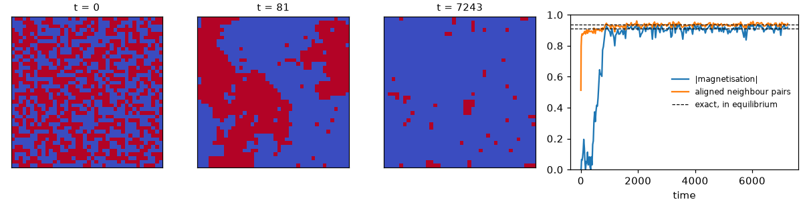

# Ising spin model with a custom rate calculator

The second example of the KMCLib manual, after the model for which the rejection-free
("n-fold way") kinetic Monte Carlo algorithm was invented.

Every site of a periodic square lattice carries a spin, up ("U") or down ("D"). The only
elementary processes are the two spin flips, but their rate depends on the four neighbouring
spins:

```
rate = min(1, exp(-ΔE / kT)),    ΔE = J · (aligned neighbours − opposite neighbours)
```

The run starts from random spins at `kT/J = 1`, below the critical temperature
(`kT_c/J = 1.13`), so the spins order.

## What it shows

- a *rate calculator*: a class derived from `KMCRateCalculatorPlugin` whose `rate` method the
  C++ backend calls to get the rate of a process in a given environment, with `cutoff` and
  `cacheRates`;
- selecting a calculator built into the backend by its name (`"IsingTestCalculator"`);
- a custom analysis derived from `KMCAnalysisPlugin` that reads `configuration.types()`.

## Run

```bash
python ising.py                    # Python rate calculator, about 10 s
python ising.py --calculator cpp   # the same model with the built-in C++ calculator
python ising.py --plot             # also writes output/ising.png (needs matplotlib)
python ising.py --size 100         # the lattice of the KMCLib manual
python ising.py --help
```

The results go to `output/`: `order.data` (time, magnetisation, fraction of aligned neighbour
pairs) and `spins_final.txt` (the final spins as +1 / −1).

## Expected result

Domains of aligned spins grow until one of them fills the 40 × 40 lattice. From then on the
magnetisation and the fraction of aligned neighbour pairs fluctuate around the exact values
of the two-dimensional Ising model (Yang 1952, Onsager 1944):

|                         | start | late in the run | exact, in equilibrium |
| ----------------------- | ----- | --------------- | --------------------- |
| \|magnetisation\|       | 0.000 | 0.912           | 0.911                 |
| aligned neighbour pairs | 0.512 | 0.937           | 0.936                 |

"Late in the run" is the average over the last quarter of the records. Five different seeds
gave 0.904 to 0.912 and 0.933 to 0.937.



On the 100 × 100 lattice of the manual, 10⁶ steps are not enough to finish the coarsening:
with the default seed two large domains are left, the fraction of aligned pairs has reached
0.91 while the magnetisation is still 0.07.

### Python or C++ calculator

Both calculators produce the same trajectory for the same seed. Because the Python calculator
lets the backend cache its rates (`cacheRates` returns `True`), Python is only called once per
distinct environment and the two are equally fast: about 35 000 steps per second on the
100 × 100 lattice on the machine used to write this, against 19 000 for the Python calculator
without caching.

## Command line

```bash
cd examples/ising
python -m pykmclib.cli --config-dir conf model=ising
python -m pykmclib.cli --config-dir conf model=ising model.rate_calculator=IsingTestCalculator
```

[`conf/model/ising.yaml`](conf/model/ising.yaml) refers to the functions and classes of
`ising.py`. `python -m` puts the working directory on the module search path, which is why the
command is run from this directory; with the `pykmclib` script use `PYTHONPATH=. pykmclib ...`.

## References

- A. B. Bortz, M. H. Kalos and J. L. Lebowitz, *A new algorithm for Monte Carlo simulation of
  Ising spin systems*, J. Comput. Phys. 17 (1975) 10.
  DOI: [10.1016/0021-9991(75)90060-1](https://doi.org/10.1016/0021-9991(75)90060-1)
- M. Leetmaa and N. V. Skorodumova, Comput. Phys. Commun. 185 (2014) 2340.
  DOI: [10.1016/j.cpc.2014.04.017](https://doi.org/10.1016/j.cpc.2014.04.017)
- L. Onsager, Phys. Rev. 65 (1944) 117. DOI: [10.1103/PhysRev.65.117](https://doi.org/10.1103/PhysRev.65.117)
- C. N. Yang, Phys. Rev. 85 (1952) 808. DOI: [10.1103/PhysRev.85.808](https://doi.org/10.1103/PhysRev.85.808)
