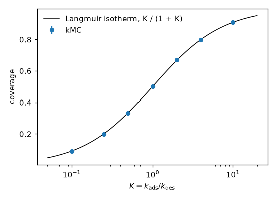

# Langmuir adsorption

The simplest surface model with an exact answer.

Every site of a square lattice is empty ("E") or holds one adsorbed molecule ("A"). Molecules
adsorb on empty sites with the rate constant `k_ads` (proportional to the gas pressure) and
desorb with the rate constant `k_des`. They do not interact. In equilibrium the fraction of
occupied sites follows the Langmuir isotherm:

```
coverage = K / (1 + K),    K = k_ads / k_des
```

## What it shows

- processes that involve a single site;
- a custom analysis derived from `KMCAnalysisPlugin` that averages an observable over *time*,
  with an error estimate from block averages;
- running a series of simulations from one script.

## Run

```bash
python langmuir.py            # about 5 s
python langmuir.py --plot     # also writes output/langmuir.png (needs matplotlib)
python langmuir.py --help
```

The results go to `output/isotherm.data`.

## Expected result

20 × 20 sites, 10⁵ steps for each value of `K`:

| K    | coverage (kMC)  | Langmuir | deviation |
| ---- | --------------- | -------- | --------- |
| 0.10 | 0.0911 ± 0.0005 | 0.0909   | +0.0002   |
| 0.25 | 0.1989 ± 0.0009 | 0.2000   | −0.0011   |
| 0.50 | 0.3334 ± 0.0013 | 0.3333   | +0.0001   |
| 1.00 | 0.5015 ± 0.0014 | 0.5000   | +0.0015   |
| 2.00 | 0.6691 ± 0.0013 | 0.6667   | +0.0024   |
| 4.00 | 0.7996 ± 0.0009 | 0.8000   | −0.0004   |
| 10.0 | 0.9099 ± 0.0005 | 0.9091   | +0.0009   |

The deviations scatter around zero and are of the size of the standard errors (up to 1.8 of
them in this run).



### Average over time, not over steps

A kMC step takes a different amount of time in every state: short when many processes are
available, long when few are. An observable therefore has to be weighted by the time the
system spends in each state, which is what the `TimeAveragedCoverage` plugin of the script
does. The built-in `Composition` analysis averages over the steps within each of its blocks
instead. For this model that shifts the coverage by about +0.001 at `K = 0.1` and −0.001 at
`K = 10`, twice the statistical error; the shift shrinks with the number of sites.

## Command line

The model is also declared entirely in YAML, in
[`conf/model/langmuir.yaml`](conf/model/langmuir.yaml). It needs nothing but pykmclib and runs
from any directory:

```bash
pykmclib --config-dir examples/langmuir/conf model=langmuir
pykmclib -m --config-dir examples/langmuir/conf model=langmuir adsorption_rate=0.1,1.0,10.0
```

It uses the `Composition` analysis, whose table is written to `analysis_0_Composition.txt` in
the output directory of the run. Write rate constants as floating point numbers (`1.0`, not
`1`).

## Reference

- I. Langmuir, *The adsorption of gases on plane surfaces of glass, mica and platinum*,
  J. Am. Chem. Soc. 40 (1918) 1361. DOI: [10.1021/ja02242a004](https://doi.org/10.1021/ja02242a004)
