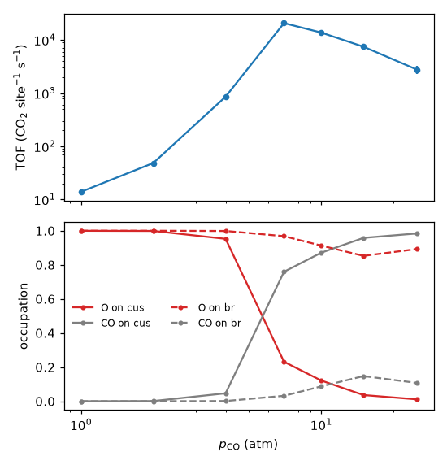

# CO oxidation at RuO₂(110)

A first-principles kinetic Monte Carlo model from the literature, reproduced with pykmclib:
K. Reuter and M. Scheffler, Phys. Rev. B 73 (2006) 045433.

## The model

The surface has two kinds of adsorption sites, bridge ("br") and coordinatively unsaturated
("cus"), arranged in alternating rows. One surface unit cell (6.43 Å across the rows, 3.12 Å
along them) holds one site of each kind:

```
   br   cus   br   cus          each site: empty ("E"), "O" or "CO"
    |    |    |    |
   br   cus   br   cus          neighbours: the two sites next to it in its own row,
    |    |    |    |            and the two sites of the rows on either side
   br   cus   br   cus
```

The processes, with their rate constants at 600 K, 7 atm of CO and 1 atm of O₂:

| process | on / between | rate constant (s⁻¹) |
| ------- | ------------ | ------------------- |
| CO adsorption | br, cus | 1.4 × 10⁹ |
| CO desorption | br / cus | 5.5 × 10⁴ / 1.8 × 10⁷ |
| O₂ adsorption on a pair of empty sites | br-br, br-cus, cus-cus | 1.9 × 10⁸ |
| O₂ desorption | br-br / br-cus / cus-cus | 8.0 × 10⁻²¹ / 6.7 × 10⁻¹⁰ / 56 |
| CO hop | br→br / br→cus / cus→br / cus→cus | 1.1 × 10⁸ / 0.45 / 150 / 0.066 |
| O hop | br→br / br→cus / cus→br / cus→cus | 1.6 × 10⁷ / 6.0 × 10⁻⁷ / 5.0 × 10⁴ / 0.45 |
| CO + O → CO₂ | CO br + O br / CO br + O cus / CO cus + O br / CO cus + O cus | 1.6 / 1.2 × 10⁶ / 520 / 1.7 × 10⁵ |

That is 22 kinds of processes, 36 `KMCProcess` objects once every direction is written out.
The paper counts 26 because it also lists the re-adsorption of CO₂, which it shows to be
negligible. The rate constants follow the paper:

- **Adsorption**: the number of molecules hitting half a unit cell per second,
  `p A / √(2π m k_B T)` with `A` half the area of the cell, for CO on a site and for O₂ on a
  pair of sites alike. Adsorption has no barrier.
- **Desorption**: from adsorption by detailed balance,
  `k_des = k_ads · exp((E_b − μ_gas) / k_B T)`, where `E_b` is the binding energy and `μ_gas`
  the chemical potential of the gas. The script computes `μ_gas` for an ideal gas of rigid
  rotors with harmonic vibrations; for oxygen at 1 atm this gives −0.27, −0.61 and −1.10 eV
  per atom at 300, 600 and 1000 K, the values tabulated by Reuter and Scheffler (2001).
- **Diffusion and reaction**: `f · (k_B T / h) · exp(−ΔE / k_B T)`, with `f = 1` for hops and
  `f = 0.5` for reactions.

The energies are those of Table III of the paper.

## What it shows

- a lattice with two different sites per cell, and processes between unlike sites;
- building a long process list from a table of energies, with physical rate constants that
  span almost 30 orders of magnitude;
- a custom analysis that counts reaction events by kind (the turnover frequency);
- a custom analysis that samples `configuration.types()` and weights the samples by time.

## Run

```bash
python ruo2_co_oxidation.py                     # scan of the CO pressure, about 1 min
python ruo2_co_oxidation.py --plot              # also writes output/ruo2_co_oxidation.png (needs matplotlib)
python ruo2_co_oxidation.py --p-co 7 --steps 1000000
python ruo2_co_oxidation.py --help
```

The results go to `output/scan.data`.

## Expected result

600 K, 1 atm of O₂, 10 × 10 unit cells (200 sites). Each run starts with oxygen on all bridge
sites and empty cus sites, takes 250 000 steps to adapt to the gas and 250 000 steps to
measure. TOF is the turnover frequency: CO₂ molecules formed per site and second.

| p(CO) (atm) | TOF (site⁻¹ s⁻¹) | O on br | CO on br | O on cus | CO on cus | share of CO cus + O cus |
| ----------- | ---------------- | ------- | -------- | -------- | --------- | ----------------------- |
| 1  | 14.0 ± 0.4          | 1.000 | 0.000 | 1.000 | 0.000 | 0.99 |
| 2  | 48.6 ± 1.4          | 1.000 | 0.000 | 0.999 | 0.001 | 0.99 |
| 4  | 858 ± 29            | 0.999 | 0.001 | 0.953 | 0.046 | 0.96 |
| 7  | (2.08 ± 0.11) × 10⁴ | 0.968 | 0.032 | 0.231 | 0.759 | 0.90 |
| 10 | (1.38 ± 0.09) × 10⁴ | 0.913 | 0.087 | 0.121 | 0.871 | 0.79 |
| 15 | (7.5 ± 0.7) × 10³   | 0.853 | 0.147 | 0.036 | 0.958 | 0.81 |
| 25 | (2.8 ± 0.5) × 10³   | 0.893 | 0.107 | 0.011 | 0.984 | 0.67 |



The surface is covered by oxygen at low CO pressure and the cus sites fill with CO at high
pressure. In between, where O and CO compete for the cus sites, the activity peaks sharply.
The paper reports these most active conditions at 7 atm of CO:

| 600 K, 1 atm O₂, 7 atm CO | this example | Reuter and Scheffler (2006) |
| ------------------------- | ------------ | --------------------------- |
| TOF (site⁻¹ s⁻¹)          | 2.1 × 10⁴    | 2.2 × 10⁴                   |
| bridge sites: O / CO      | 0.97 / 0.03  | 0.94 / 0.06                 |
| cus sites: O / CO         | 0.23 / 0.76  | 0.26 / 0.73                 |
| share of CO cus + O cus   | 0.90         | 0.86                        |
| share of CO br + O cus    | 0.08         | 0.13                        |

Things to keep in mind when comparing numbers:

- **Fluctuations.** The populations fluctuate strongly on a cell of this size, as the paper
  notes too. In eight consecutive windows of 500 000 steps at 7 atm the TOF ranged from
  2.0 × 10⁴ to 2.5 × 10⁴, the CO occupation of the bridge sites from 0.06 to 0.14 and the
  oxygen occupation of the cus sites from 0.17 to 0.25. A longer run
  (`--p-co 7 --steps 1000000`) gave a TOF of (2.21 ± 0.06) × 10⁴ with 0.10 CO on the bridge
  sites and 0.20 O on the cus sites. So the TOF agrees with the paper, and the occupations
  agree to within a few percent of the sites. The errors in the table only account for the
  counting statistics of the reaction events.
- **The bridge rows are slow.** Oxygen leaves a bridge site by reacting with CO on a cus site,
  520 times per second, while a CO molecule on a cus site desorbs 18 million times per
  second. A run of 500 000 steps covers less than a millisecond at 7 atm and above, so the
  bridge rows are still filling with CO when it ends: at 10 atm and above their occupation
  is not a steady-state value. Started from CO covered bridge sites (`--bridge CO`), a run at
  25 atm keeps them 99 % CO covered and gives a TOF of (1.9 ± 0.4) × 10³, nearly all of it
  from CO br + O cus. The paper quotes induction periods of the order of a tenth of a second.
- **Choices where the sources leave room.** The dimensions of the unit cell are those used
  for this model in the kmos package. The paper states the active area for O₂ adsorption as
  half the unit cell for each kind of pair; this example applies it to every pair of
  neighbouring sites.

## Command line

```bash
cd examples/ruo2_co_oxidation
python -m pykmclib.cli --config-dir conf model=ruo2_co_oxidation
python -m pykmclib.cli -m --config-dir conf model=ruo2_co_oxidation model.interactions.p_co=2,7,15
```

[`conf/model/ruo2_co_oxidation.yaml`](conf/model/ruo2_co_oxidation.yaml) refers to the
functions and classes of `ruo2_co_oxidation.py`, so the command is run from this directory
(with the `pykmclib` script use `PYTHONPATH=. pykmclib ...`). Each run writes
`analysis_0_TurnoverFrequency.txt` and `analysis_1_SiteOccupation.txt`; both leave out the
first half of the run.

## References

- K. Reuter and M. Scheffler, *First-principles kinetic Monte Carlo simulations for
  heterogeneous catalysis: Application to the CO oxidation at RuO₂(110)*,
  Phys. Rev. B 73 (2006) 045433.
  DOI: [10.1103/PhysRevB.73.045433](https://doi.org/10.1103/PhysRevB.73.045433)
- K. Reuter and M. Scheffler, *Composition, structure, and stability of RuO₂(110) as a function
  of oxygen pressure*, Phys. Rev. B 65 (2001) 035406 (Table I: the chemical potential of oxygen).
  DOI: [10.1103/PhysRevB.65.035406](https://doi.org/10.1103/PhysRevB.65.035406)
- M. Andersen, C. Panosetti and K. Reuter, *A practical guide to surface kinetic Monte Carlo
  simulations*, Front. Chem. 7 (2019) 202 (section 6.1 discusses this model).
  DOI: [10.3389/fchem.2019.00202](https://doi.org/10.3389/fchem.2019.00202)
- M. J. Hoffmann, S. Matera and K. Reuter, *kmos: A lattice kinetic Monte Carlo framework*,
  Comput. Phys. Commun. 185 (2014) 2138.
  DOI: [10.1016/j.cpc.2014.04.003](https://doi.org/10.1016/j.cpc.2014.04.003)
