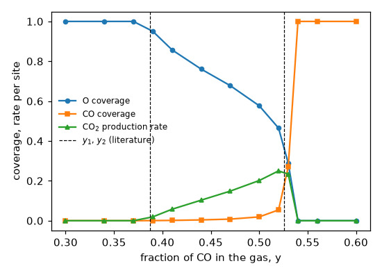

# The Ziff–Gulari–Barshad model of CO oxidation

A classic of non-equilibrium statistical physics. Three kinds of processes on a square
lattice are enough to produce two kinetic phase transitions:

- CO adsorbs on an empty site;
- O₂ adsorbs on two neighbouring empty sites and dissociates;
- adsorbed CO and O on neighbouring sites react to CO₂, which leaves at once.

The gas contains the fraction `y` of CO and `1 − y` of O₂, and nothing desorbs unreacted.
Depending on `y`, the surface ends up covered by oxygen ("O poisoned"), stays reactive, or ends
up covered by CO ("CO poisoned").

Time is measured in units of the time in which, on average, one molecule hits each site: CO
adsorbs with the rate constant `y` per empty site and O₂ with `(1 − y) / 2` per pair of empty
neighbours. The reaction of the original model is instantaneous; here its rate constant is
1000, much faster than adsorption.

## What it shows

- processes on a pair of sites, listed so that every pair is counted once;
- the built-in `Composition` analysis and its `data()`;
- a custom analysis that counts events with `configuration.latestEventProcess()`;
- a *breaker*, derived from `KMCBreakerPlugin`, that ends a run on a custom condition;
- running a model twice: the second run continues where the first one stopped.

## Run

```bash
python zgb.py            # about 30 s
python zgb.py --plot     # also writes output/zgb.png (needs matplotlib)
python zgb.py --help
```

The results go to `output/phase_diagram.data`.

## Expected result

40 × 40 sites; for each `y`, 10⁵ steps to reach the steady state and 10⁵ steps to measure.
The rate is the number of CO₂ molecules formed per site and unit of time.

| y    | CO coverage | O coverage | CO₂ rate | state       |
| ---- | ----------- | ---------- | -------- | ----------- |
| 0.30 | 0.0000      | 1.0000     | 0.0000   | O poisoned  |
| 0.34 | 0.0000      | 1.0000     | 0.0000   | O poisoned  |
| 0.37 | 0.0000      | 1.0000     | 0.0000   | O poisoned  |
| 0.39 | 0.0005      | 0.9507     | 0.0190   | reactive    |
| 0.41 | 0.0015      | 0.8571     | 0.0576   | reactive    |
| 0.44 | 0.0040      | 0.7609     | 0.1030   | reactive    |
| 0.47 | 0.0079      | 0.6779     | 0.1483   | reactive    |
| 0.50 | 0.0191      | 0.5768     | 0.2016   | reactive    |
| 0.52 | 0.0542      | 0.4646     | 0.2499   | reactive    |
| 0.53 | 0.2710      | 0.2880     | 0.2336   | reactive    |
| 0.54 | 1.0000      | 0.0000     | 0.0000   | CO poisoned |
| 0.56 | 1.0000      | 0.0000     | 0.0000   | CO poisoned |
| 0.60 | 1.0000      | 0.0000     | 0.0000   | CO poisoned |



This is the phase diagram of Ziff, Gulari and Barshad: the surface is reactive only in a
window of `y`. Large simulations in the literature place its ends at `y₁ = 0.3874` (Voigt and
Ziff 1997) and `y₂ = 0.5256` (Ziff and Brosilow 1992); the original paper gave 0.389 and 0.525.
The oxygen coverage falls continuously from 1 at the first transition, while at the second
one the CO coverage jumps.

A consistency check: in a steady state as much CO reacts as adsorbs, so the rate has to equal
`y` times the fraction of empty sites. At `y = 0.50` that is 0.50 × (1 − 0.0191 − 0.5768) =
0.2021, against the 0.2016 counted.

Things to keep in mind when comparing numbers:

- `y = 0.53` lies just above `y₂`. The surface is on its way to CO poisoning there (the CO
  coverage is already 0.27) but did not get there within the run.
- Close to `y₁` a finite lattice eventually gets poisoned by a fluctuation even when the
  infinite system would stay reactive; how long that takes grows quickly with the lattice
  size.
- The finite reaction rate is a small departure from the original model.

## Command line

```bash
cd examples/zgb
python -m pykmclib.cli --config-dir conf model=zgb
python -m pykmclib.cli -m --config-dir conf model=zgb model.interactions.y=0.35,0.45,0.50,0.55
```

[`conf/model/zgb.yaml`](conf/model/zgb.yaml) refers to the functions and classes of `zgb.py`,
so the command is run from this directory (with the `pykmclib` script use
`PYTHONPATH=. pykmclib ...`). Each run writes the coverages against time to
`analysis_0_Composition.txt` and the CO₂ rate over its second half to
`analysis_1_EventCounter.txt`.

## References

- R. M. Ziff, E. Gulari and Y. Barshad, *Kinetic phase transitions in an irreversible
  surface-reaction model*, Phys. Rev. Lett. 56 (1986) 2553.
  DOI: [10.1103/PhysRevLett.56.2553](https://doi.org/10.1103/PhysRevLett.56.2553)
- A. P. J. Jansen, *An Introduction to Kinetic Monte Carlo Simulations of Surface Reactions*,
  Springer (2012), section 7.4.3.
  DOI: [10.1007/978-3-642-29488-4](https://doi.org/10.1007/978-3-642-29488-4)
- C. A. Voigt and R. M. Ziff, Phys. Rev. E 56 (1997) R6241.
  DOI: [10.1103/PhysRevE.56.R6241](https://doi.org/10.1103/PhysRevE.56.R6241)
- R. M. Ziff and B. J. Brosilow, Phys. Rev. A 46 (1992) 4630.
  DOI: [10.1103/PhysRevA.46.4630](https://doi.org/10.1103/PhysRevA.46.4630)
